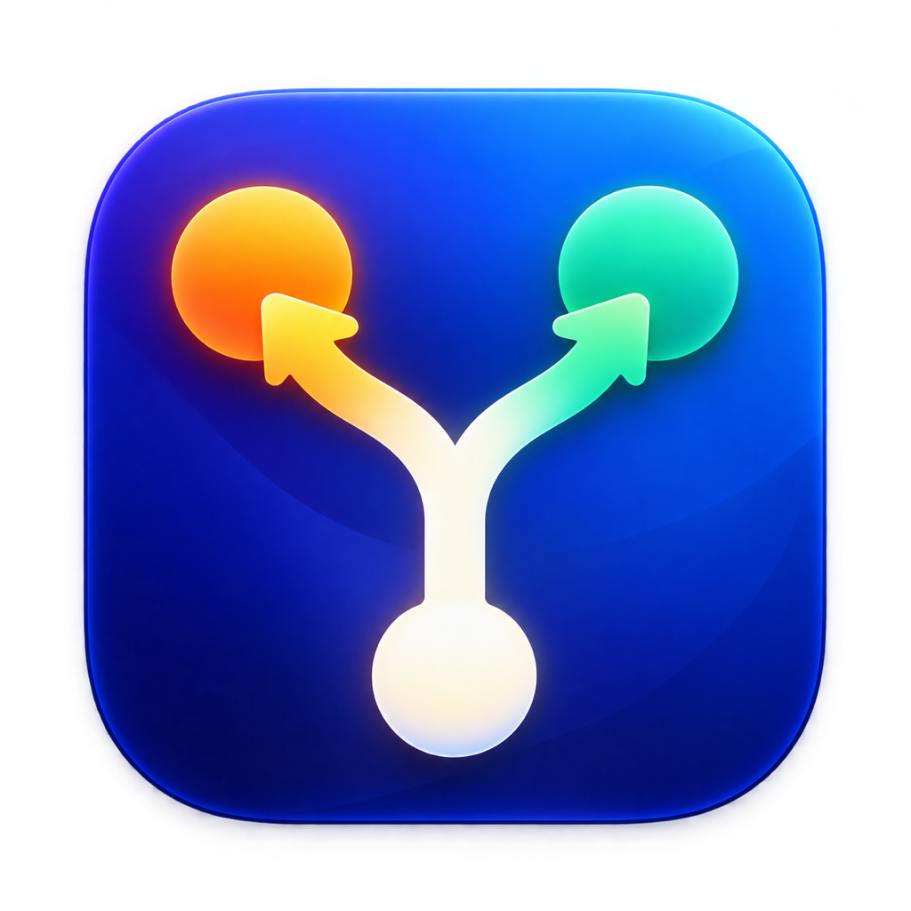
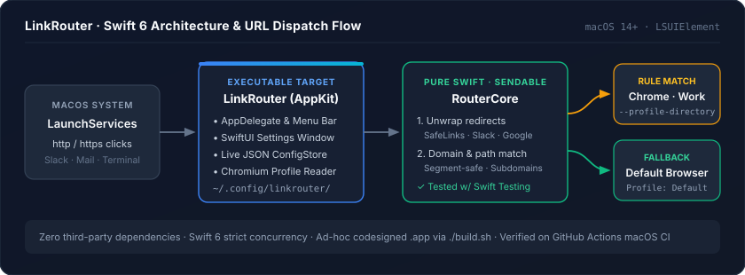

<p align="left">
  
</p>

# LinkRouter

[](https://github.com/DragarA/link-router/actions/workflows/ci.yml)
[](https://swift.org)
[](https://www.apple.com/macos/)
[](./LICENSE)

A lightweight native macOS menu-bar app written in **Swift 6** that registers as your default web browser and routes every clicked link to the right browser—or specific Chromium profile—based on domain and path rules.



## Features

- **Rule-based browser & profile routing** — Match domains, subdomains (`x.com` matches `blog.x.com`, never `notx.com`), and segment-safe path prefixes (`gitlab.com/my-group`), checked top-to-bottom with a configurable fallback browser.
- **Automatic Chromium profile detection** — Reads installed browsers via `NSWorkspace` and discovers profiles from `Local State` for Chrome, Brave, Edge, Vivaldi, and Chromium, launching directly into `--profile-directory=<dir>`.
- **Tracking & safety redirect unwrapping** — Unwraps Outlook SafeLinks (`safelinks.protection.outlook.com`), Slack redirects (`slack-redir.net`), and Google redirects (`google.com/url`) before matching rules so the *real* destination gets routed.
- **Native SwiftUI settings UI** — Menu-bar-only app (`LSUIElement`) with instant-save rules editor, drag-to-reorder priority, live "Test a link" dry-run tester, Default Browser registration, and Launch at Login (`SMAppService`).
- **Live JSON config** — Stored at `~/.config/linkrouter/config.json` and re-read on every link click so manual edits apply immediately.

## Architecture

The package is intentionally split into a pure, framework-free routing core and a thin macOS shell so all routing and config logic is strictly `Sendable` and unit-testable without AppKit:

```text
macOS LaunchServices (http/https)
        │
        ▼
┌────────────────────────────────────────┐
│  LinkRouter (Executable · AppKit/SwiftUI)
│  - AppDelegate & menu bar status item  │
│  - SettingsView / SystemIntegration    │
│  - BrowserLauncher & ConfigStore       │
└───────────────────┬────────────────────┘
                    │ depends on
                    ▼
┌────────────────────────────────────────┐
│  RouterCore (Pure Swift Library)       │
│  - Router: redirect unwrap + matching  │
│  - Config & EditableConfig models      │
└───────────────────┬────────────────────┘
                    │ verified by
                    ▼
┌────────────────────────────────────────┐
│  RouterCoreTests (Swift Testing)       │
│  - RouterTests & EditableConfigTests   │
└────────────────────────────────────────┘
```

## Build & Install

Requires **macOS 14+** and Swift 6 (Xcode Command Line Tools are sufficient—no Xcode project needed):

```bash
./build.sh
```

`build.sh` compiles a release binary with SwiftPM, generates the `.icns` bundle from `Resources/AppIcon-1024.png`, ad-hoc signs `LinkRouter.app`, installs it to `~/Applications/LinkRouter.app`, and registers it with LaunchServices. Open LinkRouter once to set it as your default browser and configure rules.

## Running Tests

```bash
# With Xcode installed:
swift test

# With Command Line Tools only (no Xcode):
./test.sh
```

## Configuration

LinkRouter creates a starter `~/.config/linkrouter/config.json` on first launch:

```json
{
  "browsers": {
    "work": { "app": "com.google.Chrome", "profile": "Profile 1" },
    "personal": { "app": "com.google.Chrome", "profile": "Default" }
  },
  "default": "personal",
  "rules": [
    {
      "name": "GitLab",
      "enabled": true,
      "match": ["gitlab.com/companyname"],
      "browser": "work"
    }
  ]
}
```

## License

[MIT](./LICENSE)
